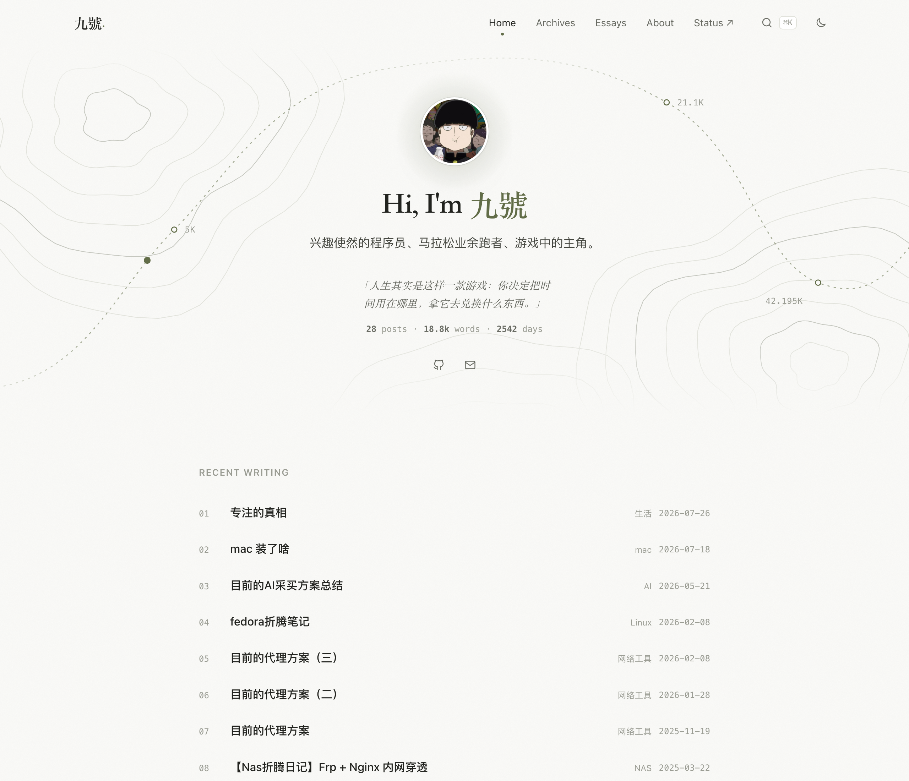
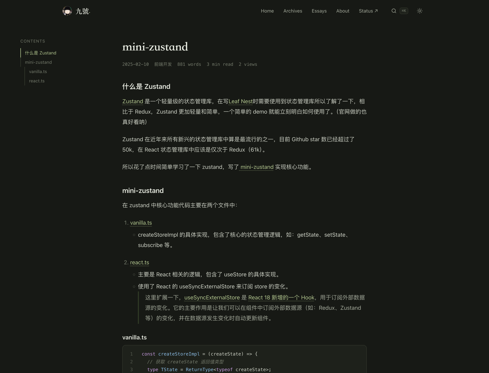

# hexo-theme-vellum

A quiet, typographic Hexo theme: warm paper palette, serif display type, a numbered "Recent Writing" index, a side table of contents on articles, an essays timeline and ⌘K search. Light and dark modes follow the system and can be toggled.





## Install

Clone into your blog's `themes/` folder (or symlink a local checkout there):

```sh
git clone https://github.com/jhao0413/hexo-theme-vellum themes/vellum
```

Then set the theme in the site `_config.yml`:

```yaml
theme: vellum

# Recommended: the home page and archives show full lists
index_generator:
  per_page: 0
archive_generator:
  per_page: 0
  yearly: true
  monthly: false

# Search (requires hexo-generator-searchdb)
search:
  path: search.json
  field: post
  content: true
  format: striptags
```

## Configure

Override any key from the theme's [`_config.yml`](./_config.yml) in a `_config.vellum.yml` file at the site root.

The home hero decoration is set with `home.decor`:

- `print` (default): a printer's proof sheet, with crop marks, registration marks, a faint baseline grid, a color bar and a slug line
- `none`: no decoration

## Pages

| Page | Front matter |
| --- | --- |
| Essays timeline (reads `source/_data/essays.yml`) | `type: essays` |
| Tag cloud | `type: tags` |
| Category list | `type: categories` |

`essays.yml` holds a list of `{ content, date }` entries.

## Features

- Home: avatar, greeting, bio, latest essay as a quote, post/word/day stats, social links, recent posts and essays
- Articles: side TOC on wide screens, reading progress bar, word count and reading time, code copy buttons, image zoom, previous/next links
- Archives, tags and categories grouped by year
- ⌘K or `/` opens search
- Gitalk comments, loaded lazily (uses the same issue key as hexo-theme-redefine)
- Optional vercount page views and raw `head_inject` HTML (e.g. analytics)

## License

MIT
